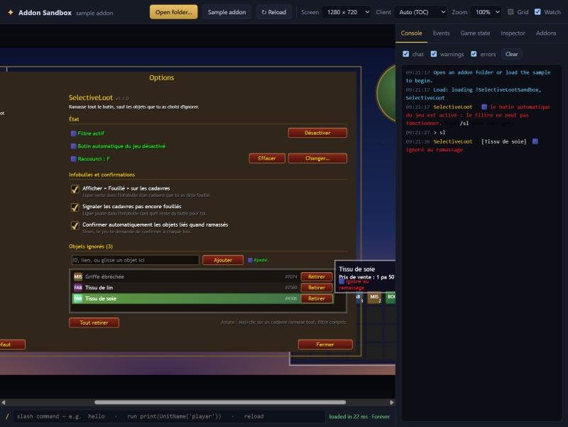

# SelectiveLoot

Addon pour **World of Warcraft: Forever** : tu fouilles comme d'habitude, l'addon ramasse tout **sauf** les objets que tu as choisi d'ignorer.

## Fonctionnalités

- **Filtre de butin** : tout est ramassé (or, objets, monnaies), sauf les objets de ta liste d'ignorés. Les objets de quête sont toujours ramassés.
- **Maj+clic** sur un cadavre ramasse tout, filtre compris.
- **Raccourci clavier** : survole un objet (sac, butin, banque…) et appuie sur ta touche pour l'ignorer ou le ramasser à nouveau.
- **Infobulles** :
  - objet ignoré : ligne rouge « Ignoré au ramassage » (rien n'est ajouté pour les autres objets) ;
  - cadavre déjà fouillé : ligne verte « Fouillé », avec le nombre d'objets ignorés laissés ;
  - cadavre pas encore fouillé : ligne jaune « Pas encore fouillé ».
- **Options dans le menu du jeu** (Options > AddOns > SelectiveLoot, ou `/sl`) :
  - état du filtre, du butin automatique du jeu et du raccourci, avec un bouton pour corriger ;
  - choix du raccourci directement depuis le panneau, avec avertissement si la touche est déjà utilisée ;
  - liste des objets ignorés : ajout par ID, lien ou glisser-déposer, bouton « Retirer » sur chaque ligne.

Code couleur partout : **vert** = c'est bon, **jaune** = à faire, **rouge** = problème ou objet ignoré, **gris** = détail.

## Installation

1. Télécharge le dépôt (bouton **Code > Download ZIP**).
2. Copie le dossier `SelectiveLoot` dans `World of Warcraft\_forever_\Interface\AddOns\`.
3. En jeu, tape `/sl` : si le butin automatique du jeu est activé, clique sur **Corriger** (le filtre en a besoin), puis choisis ton raccourci.

Ne copie pas le dossier `tests` dans le jeu.

## Commandes

| Commande | Effet |
|---|---|
| `/sl` | Ouvre les options |
| `/sl add <lien ou ID>` | Ignore un objet |
| `/sl del <lien ou ID>` | Ne l'ignore plus |
| `/sl on` / `/sl off` | Active ou désactive le filtre |

## Limites connues

- L'animation de scintillement d'un cadavre est gérée par le jeu : elle reste tant que des objets ignorés sont sur le corps. L'infobulle « Fouillé » sert à les reconnaître.
- La fenêtre de butin peut s'afficher une fraction de seconde avant de se refermer quand il ne reste que des objets ignorés.
- Si le jeu masque l'identité des cadavres aux addons, les lignes « Fouillé » / « Pas encore fouillé » n'apparaissent pas. Le filtre continue de fonctionner.

## Tests

`tests/!SelectiveLootSandbox` simule le butin, des cadavres, un sac, le menu Options et les raccourcis pour tester l'addon dans [wow-addons-sandbox](https://github.com/srrmke/wow-addons-sandbox) sans lancer le jeu. Les captures sont dans `tests/captures`.
